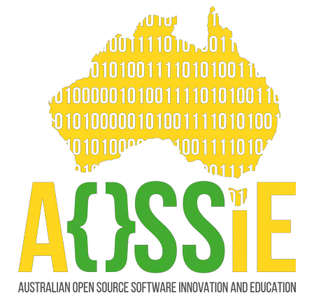

<!-- Don't delete it -->

<!-- Organization Logo -->

  

&nbsp;

<!-- Organization/Project Social Handles -->

<!-- Telegram -->

&nbsp;&nbsp;
<!-- X (formerly Twitter) -->

&nbsp;&nbsp;
<!-- Discord -->

&nbsp;&nbsp;
<!-- Medium -->

&nbsp;&nbsp;
<!-- LinkedIn -->

&nbsp;&nbsp;
<!-- Youtube -->

---

<h1>Org Maintenance</h1>

This repo contains workflows to automatically maintain the organization.
